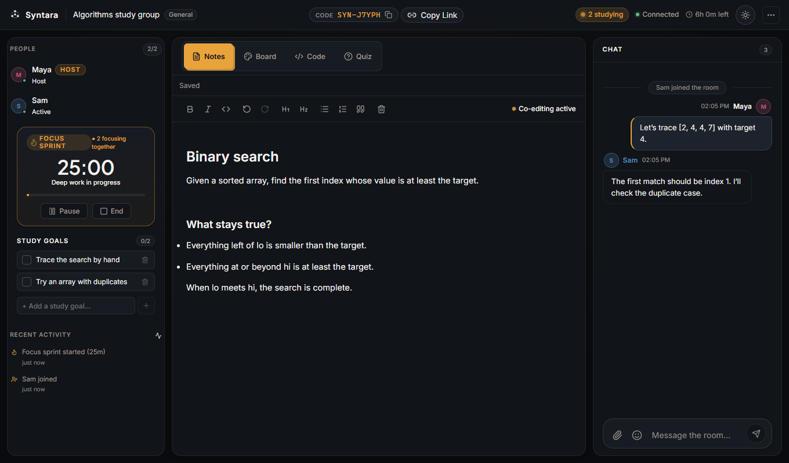
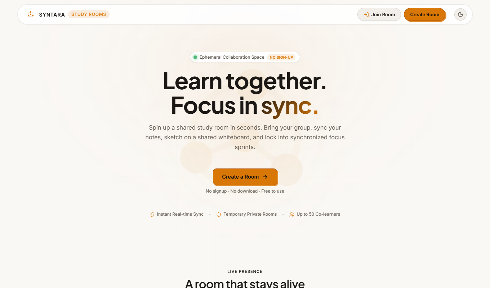
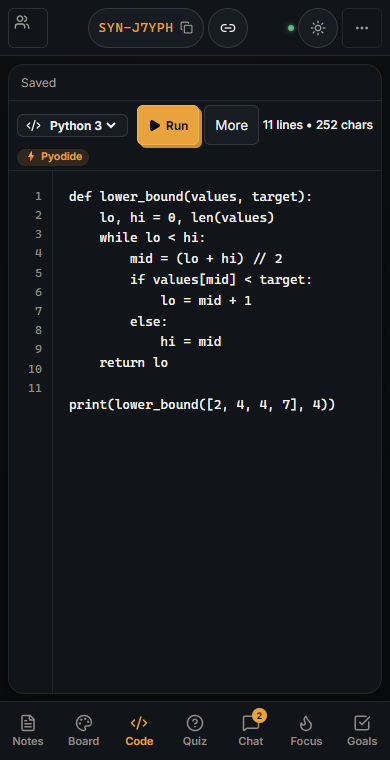
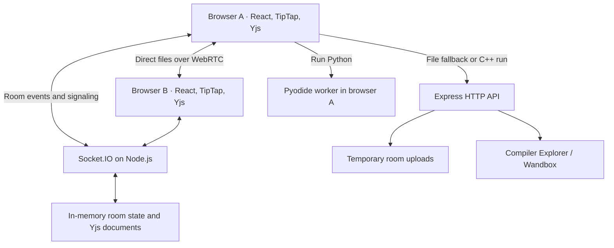

# Syntara

Syntara is a temporary study room you open with a link or room code. Two people can edit the same notes, sketch on the same whiteboard, and run code while they exchange messages. Anyone can join with a display name.

**[Open Syntara](https://syntara-hism.onrender.com/)** · [System architecture](#system-architecture) · [Run locally](#run-locally) · [Tests](#tests)



## Try a room

1. Choose **Create Room** on the homepage. Pick **Study Room** for the full workspace or **Chat Room** for messages and file sharing.
2. Choose **Copy Link** on the room pass and send it to a friend. They can also enter the room code using **Join Room**.
3. Open **Notes** and type in different paragraphs together. Switch to **Board** to draw a diagram or **Code** to try the example. The host can start a focus sprint or quiz for everyone.

### Homepage



### Mobile code editor

On phones, the bottom navigation switches tools. **Run** stays visible in the code editor, with **Copy** and **Clear** under **More**.



## System architecture



Both browsers can use the HTTP API and run Python locally. The diagram shows those paths once for readability.

- **Notes and code.** Each editor updates a local Yjs document as you type. Clients exchange changes with the server over Socket.IO. State vectors tell each side which edits it is missing, so concurrent typing and edits made during a brief disconnect can merge. The browser caches document snapshots in session storage.
- **Drawing and session tools.** Peers see strokes while the pointer is down. The server keeps completed strokes for participants who join later. Undo removes the artist’s own last stroke. The same room connection carries chat, presence, shared goals, focus deadlines, and quiz results.
- **Files and code execution.** WebRTC sends file chunks directly to connected peers and checks delivery receipts. If direct delivery is unavailable, the sender can fall back to an authenticated temporary upload. Python downloads Pyodide on first use and runs in a browser worker. Running C++ sends the source to Compiler Explorer through the backend, with Wandbox as a fallback.

**Room lifetime.** The backend holds active rooms in memory. A server restart ends those sessions. An unexpected disconnect has a two-minute reconnect window by default. When a room expires or its last participant explicitly leaves, the server removes the room and its temporary uploads.

The React 19 frontend is built with Vite. Start with the [room UI](client/src/features/room) and [collaboration hooks](client/src/hooks) to trace a browser action. On the backend, the [Socket.IO handlers](server/src/socket/handlers) update the [room store](server/src/rooms), while the [Express API](server/src/app.js) handles file transfers and code execution requests.

## Run locally

Use Node.js **22.12 or later** and npm. The default configuration works on localhost.

```sh
git clone https://github.com/AyushRaj2506/Syntara.git
cd Syntara
npm ci --prefix server
npm ci --prefix client
```

From the repository root, start the backend in one terminal and Vite in a second.

| Terminal | Command | Open |
| --- | --- | --- |
| Backend | `npm run dev --prefix server` | [Health check](http://localhost:4000/health) |
| Frontend | `npm run dev --prefix client` | [Local app](http://localhost:5173) |

To test with a second participant on one machine, open the invite link in a private window and enter a different display name.

## Tests

Run these commands from the repository root after installing both packages. The browser suite uses Google Chrome locally and starts its own servers on ports 4011 and 5175.

```sh
npm test --prefix server
npm run lint --prefix client
npm run build --prefix client
npm run test:e2e --prefix client
```

The browser tests exercise three-person simultaneous editing and drawing, reconnect recovery, invite links, file delivery, and mobile controls. CI runs the suite with Playwright Chromium. [Browser tests](client/tests) · [Backend tests](server/test) · [CI workflow](.github/workflows/ci.yml)

## Deployment and configuration

The Render blueprint builds the React frontend into `client/dist` and starts a single Node.js backend. Set `VITE_SERVER_URL` to the backend’s HTTPS origin **before building the client**. Set `CLIENT_ORIGIN` on the server to the frontend’s exact origin. The backend listens on `PORT` and reports its deployed revision at `/health`. [Render blueprint](render.yaml)

For a custom local setup, copy the relevant example to `.env` in the same directory. The server example includes the room cleanup interval, reconnect window, and room creation limit. [Client settings](client/.env.example) · [Server settings](server/.env.example) · [Upload limits and operational details](VERIFICATION.md)

## License

ISC.
